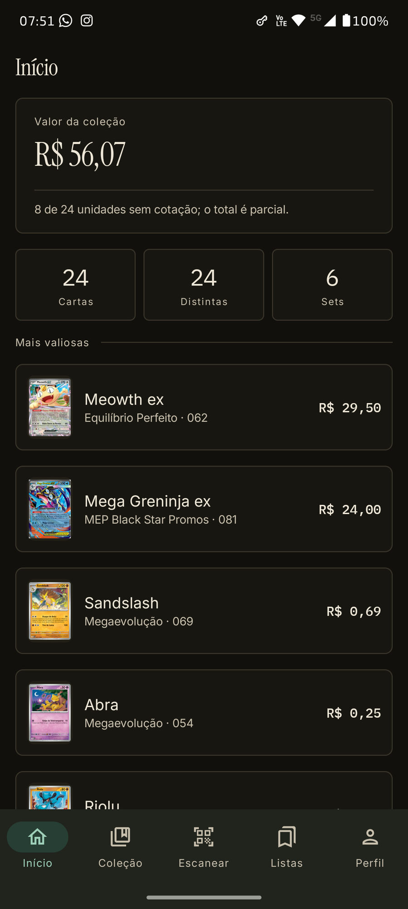
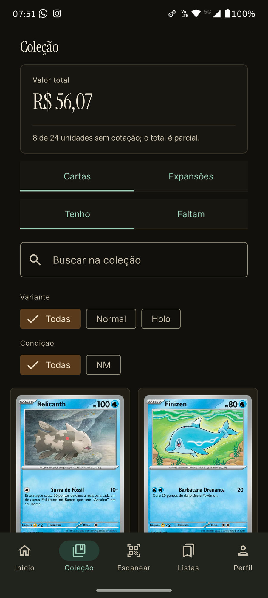
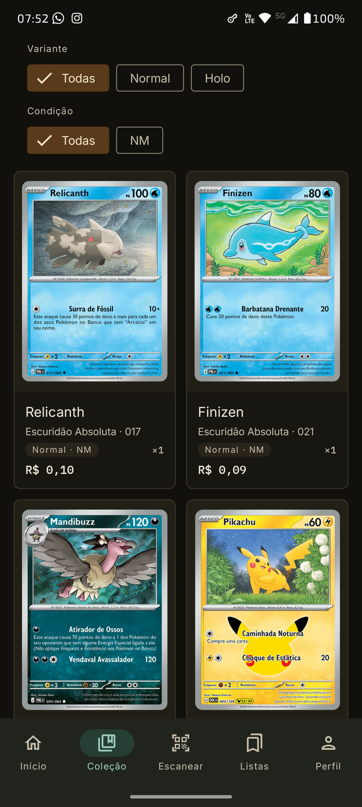
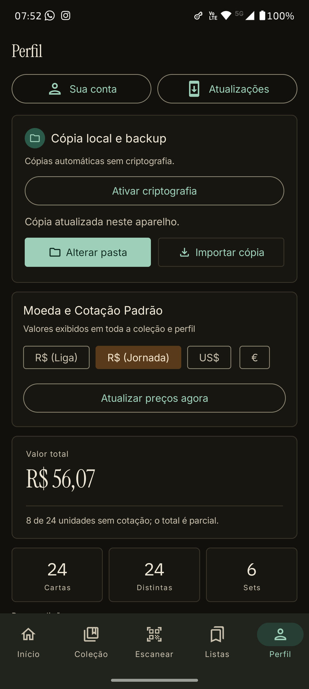

# TCG Coleção

[](https://github.com/bashln/tcg-colecao/actions/workflows/ci.yml)
[](LICENSE)


Aplicativo Android e versão web para organizar uma coleção de cartas Pokémon: escanear uma carta com a câmera, confirmar o resultado, registrar quantidade, condição, variante e preço pago, e acompanhar o valor do acervo. A coleção fica no aparelho por padrão e funciona sem conta e sem internet. A conta é opcional e sincroniza a mesma coleção entre Android e navegador.

<p align="center">
  
  
</p>
<p align="center">
  
  
</p>

## Visão Geral e Problema Resolvido

Coletores de cartas costumam controlar o acervo em planilhas ou em aplicativos com anúncios, limites de leitura e assinatura. TCG Coleção resolve isso com um fluxo local-first. A leitura da carta roda no próprio aparelho, a coleção não é enviada a nenhum servidor sem conta, e não há rastreamento, anúncio ou relatório automático de erro. O projeto inclui escaneamento, busca e filtros, lista de faltantes, listas secundárias, backup JSON e sincronização opcional entre Android e web.

## Arquitetura e Decisões Técnicas

- `:core` é um módulo Kotlin JVM puro, sem dependência do Android. Ele contém o domínio compartilhado, e os testes de domínio rodam na JVM. `:app` depende de `:core` e concentra a interface Compose, a injeção com Hilt, o armazenamento Room, a câmera CameraX e o OCR com ML Kit.
- A interface Android usa Jetpack Compose com Material 3, Navigation Compose e Hilt. ViewModels mantêm o estado da tela. A navegação e os estados de carregamento e erro têm tratamento explícito.
- O armazenamento local usa Room para a coleção, preços e snapshots. Migrações e consultas ficam no módulo de dados, separadas da UI.
- O OCR roda localmente com ML Kit no Android e com Tesseract.js na web. A foto não é enviada a nenhum servidor; apenas o texto reconhecido segue para a busca no catálogo TCGdex.
- A versão web fica em `web/` e usa React 19, TypeScript e Vite. A coleção é persistida no IndexedDB, com busca manual no TCGdex, edição exata, remoção confirmada, filtros e lista de faltantes.
- A sincronização é opcional e usa Supabase. O cliente usa apenas a chave publishable. Row Level Security protege o acesso aos dados. As migrações e o harness de PostgreSQL ficam em `supabase/`, com RPCs para push, conflito e vínculo entre dispositivos.
- O backup é um arquivo JSON versionado, com importação validada, mesclagem por quantidade, recusa de conflito e limite de 50 MB. A importação não substitui a coleção sem confirmação.
- O workflow de release falha antes de publicar quando falta keystore ou configuração do Supabase. Ele valida a assinatura do APK com um certificado fixado e não publica quando os testes de unidade falham.
- O app não envia a coleção sem conta e não inclui rastreamento, anúncio ou relatório automático de erro. A política completa está em `docs/privacy.md`.

## Pré-requisitos e Instalação Rápida

Requisitos:

- JDK 17.
- Android SDK com `platforms;android-35` e `build-tools;35.0.0`.
- Node 26 ou mais recente, para a versão web e os testes do Supabase.
- Supabase CLI, apenas para aplicar o schema no projeto remoto.

Clone o repositório e configure o ambiente:

```sh
git clone https://github.com/bashln/tcg-colecao.git
cd tcg-colecao
cp .env.example .env
set -a; . ./.env; set +a
```

O Gradle e os scripts leem variáveis de ambiente, não o arquivo `.env`. Use o bloco acima no shell atual. Preencha `.env` apenas se for usar sincronização ou assinatura de release. Para rodar sem conta, deixe as variáveis de Supabase vazias.

Testes e build Android:

```sh
./gradlew :core:test :app:testDebugUnitTest
./gradlew :app:assembleDebug
```

O APK de debug fica em `app/build/outputs/apk/debug/app-debug.apk`.

Versão web:

```sh
cd web
cp .env.example .env.local
npm ci
npm run test:unit
npm run build
npm run dev
```

O arquivo `.env.local` é opcional. Deixe as variáveis vazias para usar a coleção sem conta.

Harness Supabase:

```sh
cd supabase/tests
npm ci
npm test
```

Verificação local completa:

```sh
./gradlew :core:test :app:testDebugUnitTest :app:assembleDebug
cd web && npm ci && npm run test:unit && npm run build
cd ../supabase/tests && npm ci && npm test
```

## Uso / Exemplos / Demonstração

Exemplo de fluxo de uso:

1. Abra o app e escolha **Escanear**.
2. Fotografe ou selecione uma imagem da carta.
3. Confirme o resultado da leitura antes de salvar.
4. Ajuste quantidade, condição, variante e preço pago.
5. Use **Faltam** para ver as cartas ausentes de expansões com catálogo completo.
6. Exporte o backup JSON em **Perfil**.

<!-- TODO: Adicionar screenshot da tela de escaneamento -->
<!-- TODO: Adicionar screenshot da coleção com filtros -->
<!-- TODO: Adicionar screenshot da lista de faltantes -->
<!-- TODO: Adicionar screenshot da versão web -->

Exemplo de build com sincronização habilitada:

```sh
export TCG_SUPABASE_URL=https://your-project.supabase.co
export TCG_SUPABASE_PUBLISHABLE_KEY=sb_publishable_replace-me
./gradlew :app:assembleDebug
```

Exemplo de verificação da sincronização hospedada:

```sh
export TCG_SUPABASE_URL=https://your-project.supabase.co
export TCG_SUPABASE_PUBLISHABLE_KEY=sb_publishable_replace-me
export HOSTED_EMAIL_A=account-a@example.test
export HOSTED_PASSWORD_A=replace-me
export HOSTED_EMAIL_B=account-b@example.test
export HOSTED_PASSWORD_B=replace-me
node scripts/verify-hosted-sync.mjs
```

## Privacidade

A coleção fica no aparelho. Sem conta, ela não é enviada a nenhum servidor. Não há rastreamento, anúncio ou relatório automático de erro. A política completa está em [docs/privacy.md](docs/privacy.md).

## Contribuir

Abra uma issue para relatar um problema ou sugerir algo. Se o relato envolver a sua coleção, descreva o caso sem anexar o backup. A coleção é pessoal e o backup carrega todos os seus itens.

## Licença

GNU General Public License v3.0. Veja [LICENSE](LICENSE).
